<div align="center">


# ちいかわ討伐ディフェンス

**Chiikawa Tobatsu Defense**: a lane defense game set in Nagano's ちいかわ world

ちいかわの世界を舞台にしたレーン防衛ゲーム（非公式ファンゲーム）

### [▶ Play it in your browser](https://phuahjinwei.github.io/Chiikawa-Toubatsu-Defence/)

Free · nothing to install · phone or computer · 日本語 / English · plays offline once loaded

</div>

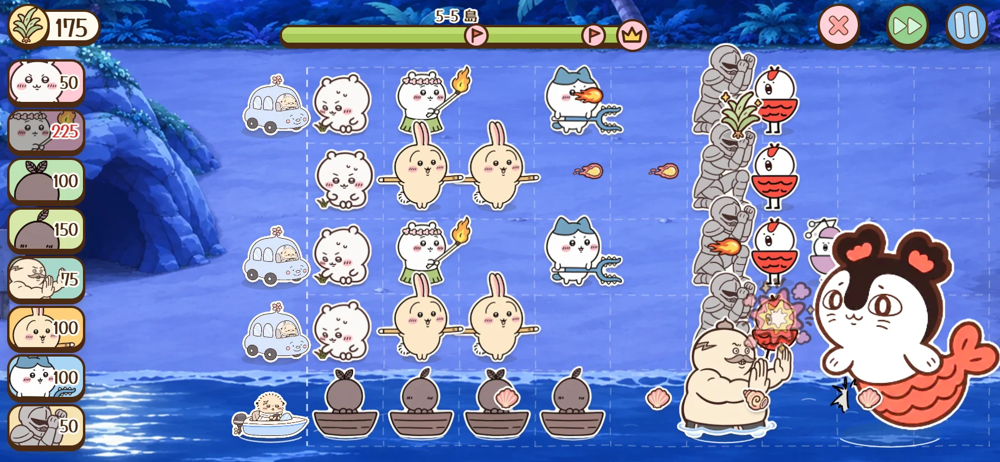

> **Unofficial, non-commercial fan game.** ちいかわ is the work of ナガノ. This project has no
> connection to the creator, the publisher or any rights holders. The art is the owner's own; the
> sounds are synthesised by code until recorded ones arrive.

## The job

Chimeras, witches and stranger things keep turning up where Chiikawa and friends live, and the 鎧さん at the job
counter pays for 討伐 (subjugation) work. Take a job, hold the lanes with your friends, pull 草 (weeds) to afford more
of them, and get paid when the job is done.

Enemies walk in from the right. Your friends stand on a field of five lanes and stop them before they reach the place
you are protecting on the left. One simple ability each, one new thing at a time, and a job takes a few minutes.

## How to play

1. **Pick your team** on the job notice: five friends to start, up to eight once you buy bigger pochettes.
2. **Put friends down.** Tap a card, then a tile, or drag the card onto the field. Each friend costs 草 and needs a
   moment before the next one.
3. **Pull weeds.** Tap the 草 that sprout on the field, or let them be collected for you (Settings). ちいかわ finds
   草 too, so put a few down early.
4. **Hold every lane.** If an enemy slips through, ラッコ's rescue car drives down that lane, once per lane.
5. **Get paid.** Three stars if the car never had to go, money for the shop, and on many first clears a new friend.

## Six worlds, thirty jobs

<table>
  <tr>
    <td width="50%">
      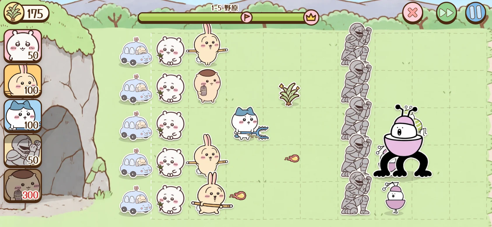<br>
      <b>1 · 野原 Meadow</b><br>
      Protect ハチワレの洞窟. The lanes open one, three, then five at a time, and the bugs' boss 虫（ピンク） waits at the end.
    </td>
    <td width="50%">
      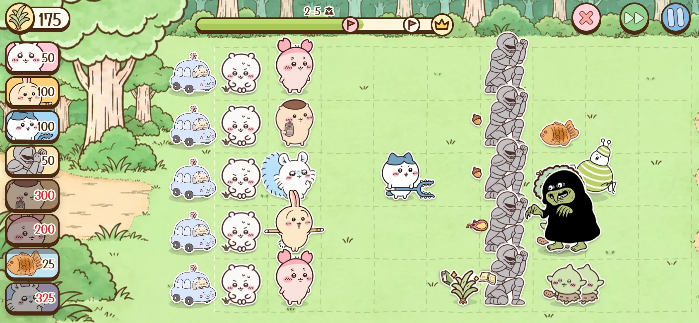<br>
      <b>2 · 森 Forest</b><br>
      Stumps and bushes crowd the field, goblins make off with your weeds, and the Rock-Paper-Scissors Mimic's song freezes friends.
    </td>
  </tr>
  <tr>
    <td width="50%">
      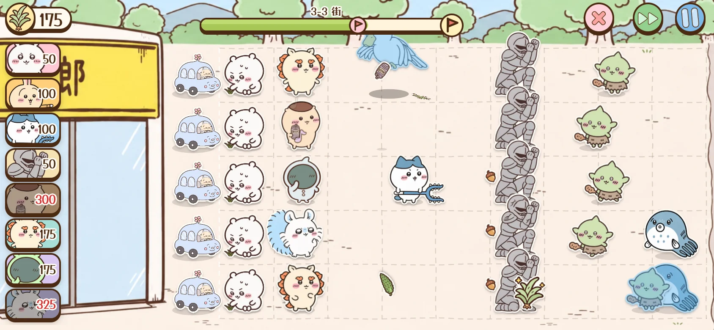<br>
      <b>3 · 街 Town</b><br>
      In front of ラーメン屋「郎」: fliers, heavy hitters, ゾウ partway through a job, and ちいかぶ, who walks in small and shows its true form up close.
    </td>
    <td width="50%">
      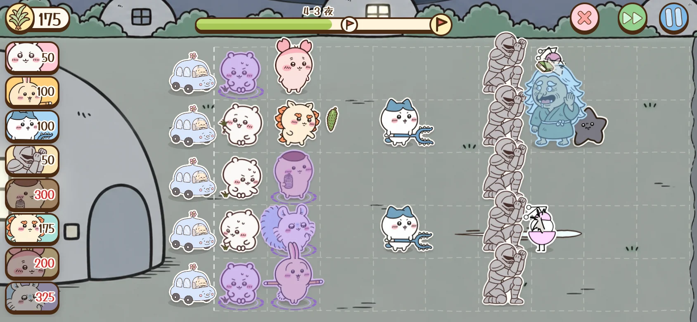<br>
      <b>4 · 夜 Night</b><br>
      Guard ちいかわの家. Nothing sprouts at night, so ちいかわ makes every 草. Black stars heal the enemies around them, and the giant あのこ comes down three lanes at once.
    </td>
  </tr>
  <tr>
    <td width="50%">
      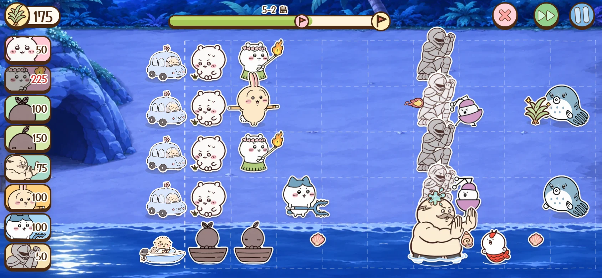<br>
      <b>5 · 島 Island</b><br>
      The bottom lane is sea. 人魚 swim down it in threes, only the islanders ヒトハ, フタバ and 島二郎 can stand on it, and セイレーン calls up followers.
    </td>
    <td width="50%">
      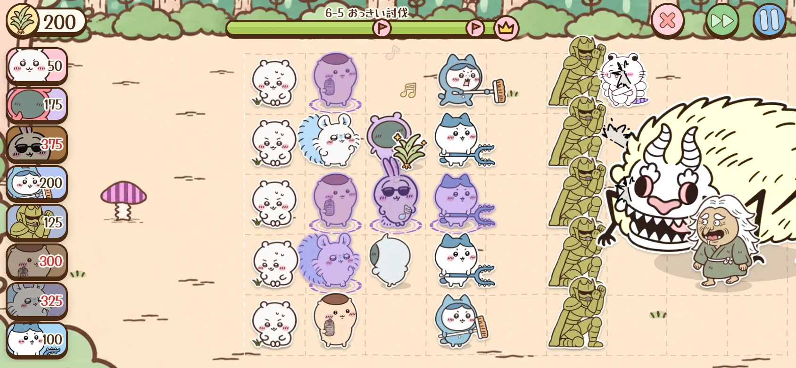<br>
      <b>6 · おっきい討伐 The Big Hunt</b><br>
      No rescue cars this time. The big ones come together, 山姥 freezes friends with spells, and the biggest of all, でかつよ, closes the hunt.
    </td>
  </tr>
</table>

Clearing the last job opens **endless mode**: wave after wave of everyone you have met, paid by the wave, on a
ranking where ラッコ already holds first place.

## Between jobs

<table>
  <tr>
    <td width="50%">
      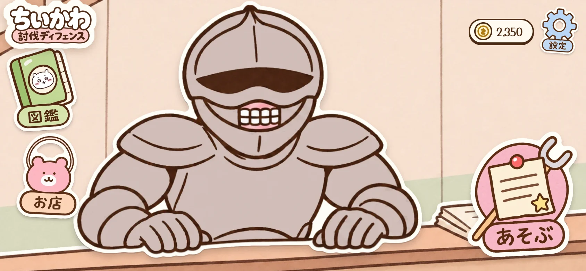<br>
      <b>Lobby</b><br>
      The job counter. The 図鑑 and the shop are on the left; あそぶ takes you to the quest board.
    </td>
    <td width="50%">
      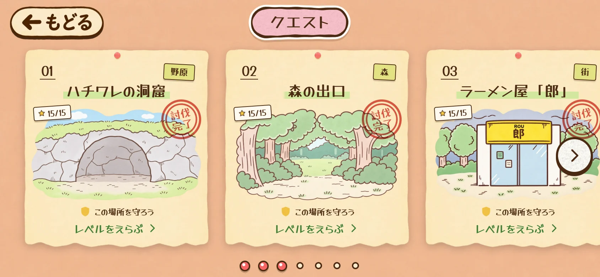<br>
      <b>Quest board</b><br>
      One quest paper per world. Clear its five jobs for the 討伐完了 stamp, and three stars on each for all fifteen.
    </td>
  </tr>
  <tr>
    <td width="50%">
      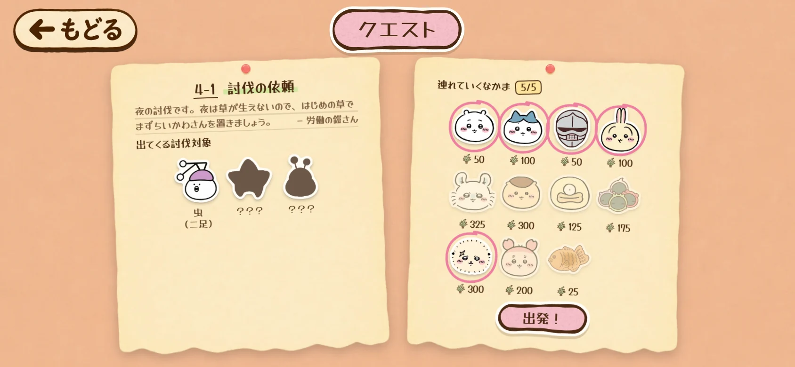<br>
      <b>Job notice</b><br>
      労働の鎧さん's note, who is coming (anyone you have never met stays a dark shape), and the team you will take.
    </td>
    <td width="50%">
      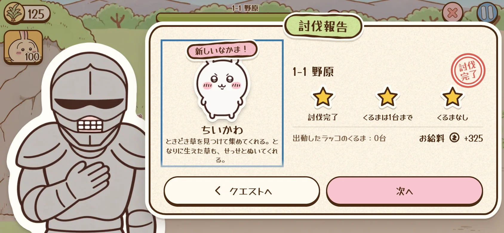<br>
      <b>Job report</b><br>
      Stars, pay, and the friend who joins you. Here ちいかわ comes along after the very first job.
    </td>
  </tr>
  <tr>
    <td width="50%">
      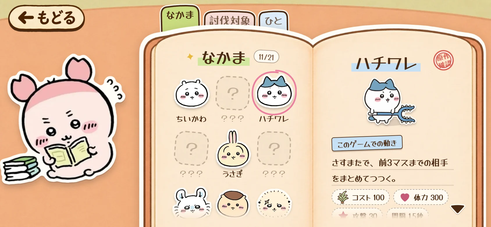<br>
      <b>図鑑</b><br>
      Kept by 古本屋: everyone you have met, what they do in the game, and a little of their story.
    </td>
    <td width="50%">
      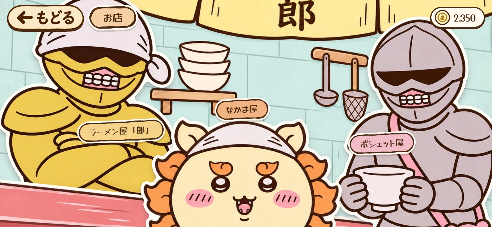<br>
      <b>Shop</b><br>
      Inside ラーメン屋「郎」: ramen tickets for extra 草, bigger pochettes for a bigger team, and シーサー's なかま屋.
    </td>
  </tr>
</table>

## What's in it

- **21 friends**, each with one thing they do: ちいかわ finds 草, ハチワレ pokes everything three tiles ahead with the
  さすまた, うさぎ swings the 討伐棒, 鎧さん holds the line, モモンガ throws acorns into three lanes, 栗まんじゅう lobs
  cans over walls. Most join as you clear jobs; シーサー and 星 are sold at the なかま屋.
- **20 kinds of enemies**, each with one simple trick: goblins pick your weeds, フグ spits from
  three tiles away, 黒い星 heal their neighbours, でかい鳥 flies over walls and carries a friend off.
- **A gentle tone.** Nobody dies on screen: defeated enemies collapse and fade, and friends just fade away.
- **Plays anywhere.** Landscape, in a phone or computer browser. Add it to your home screen to play offline. The save
  stays on your device, and Settings → セーブを書き出す gives you a code to move it to another one.
- **日本語 and English**, switched in Settings.

## Run it yourself

```bash
npm install
npm run dev
```

TypeScript, Preact and Canvas 2D on Vite, with no backend. Commands, bringing in art, editing content, deploying and
debugging are in [DEVELOPMENT.md](DEVELOPMENT.md); the design is in [GDD.md](GDD.md).

## Credits

Game design and code for this fan project. Fonts: [Zen Maru Gothic](https://fonts.google.com/specimen/Zen+Maru+Gothic)
(SIL Open Font License) via Fontsource. The sounds are synthesised by code in this repository until recorded ones arrive.
